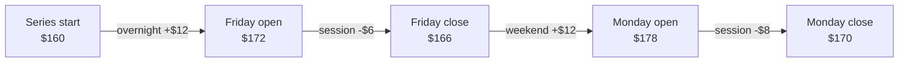
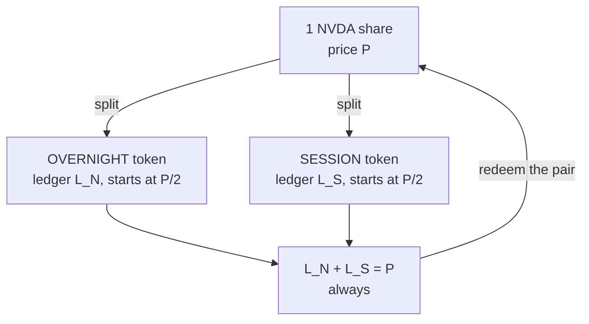
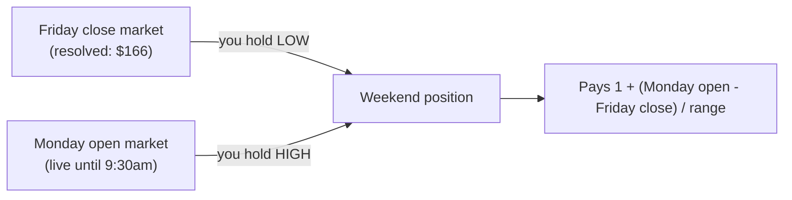
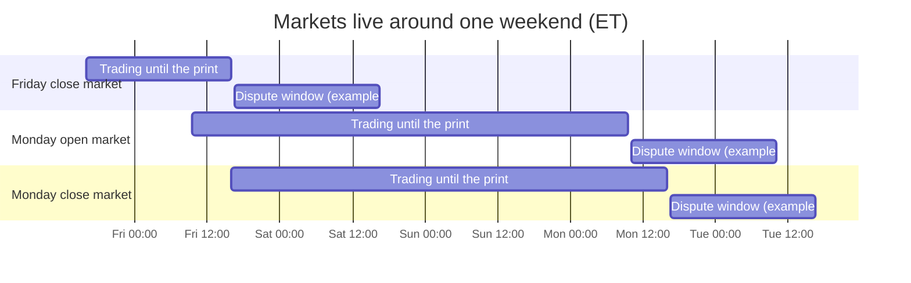
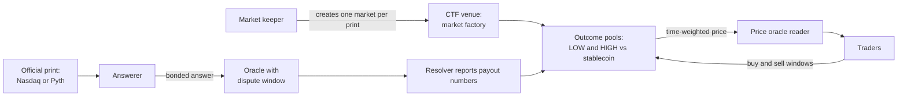
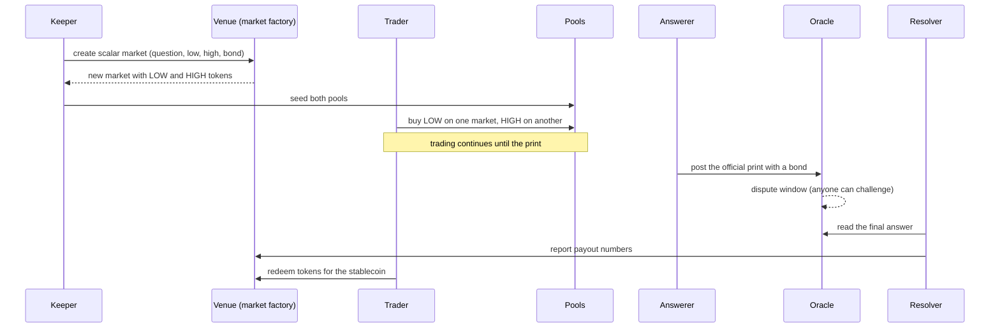
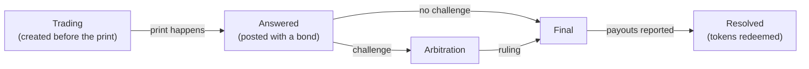
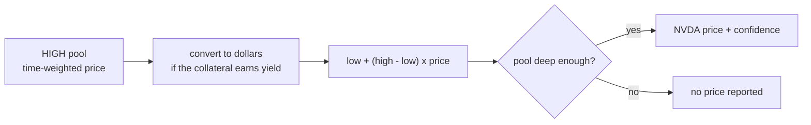

# Trading NVDA's nights and weekends with prediction markets

> **tl;dr:** 97.6% of SPY's gain since 1993 came while the market was closed. Almost nobody can trade just that part, because it means buying every close and selling every open. We show how numeric prediction markets can package nights and weekends as their own tokens, on any venue built on the Conditional Tokens Framework. One market per official NVDA print turns "Friday close to Monday open" into two tokens. The same markets also yield an off-hours NVDA price that does not depend on perpetual-futures venues, as an independent check on the 24/7 oracles that now exist.

## Where this came from

[0xbeans shared](https://x.com/0xbeans/status/2115423663231303727?a=xQLs-FIw5m-6eyeljQc&s=20) a paper, *Isolated Exposure Tokens* (The Standard Reserve, October 2026), which splits a tokenized stock into two tokens: one captures the overnight move, the other the trading-day move. The goal here is to build the same mechanism on top of prediction markets and to reproduce the paper's worked example, which starts at $160 and evolves over a few days.

## The Problem: Most of the Return Happens Overnight

The paper's first table decomposes SPY's return from January 29, 1993 to November 15, 2025 into the part earned from each close to the next open and the part earned from each open to the close.

| | Overnight only | Intraday only |
|---|---|---|
| Cumulative return | +1,105.62% | +26.84% |
| $10,000 at the start | $120,562 | $12,684 |
| Sharpe ratio | 0.769 | 0.124 |
| Share of total gain | 97.6% | 2.4% |

Holding only the overnight part has been impractical, since it requires trading at every close and every open. A tokenized stock changes this: it trades continuously against a stablecoin, while NYSE still publishes an official open and close. That combination makes the split possible.

## Tokenized Stocks Need an Independent Off-Hours Price

A tokenized stock trades around the clock, but the exchange price it tracks exists only 6.5 hours per weekday. For the remaining ~135 hours a week, lending markets, margin systems and settlement still need an answer to "what is NVDA worth right now?".

The major oracles now cover this. Chainlink launched [24/5 US equities streams](https://www.coindesk.com/business/2026/01/20/chainlink-expands-data-streams-to-cover-multitrillion-dollar-u-s-stock-market) in January 2026 and a [24/7 layer](https://www.cryptotimes.io/2026/10/29/chainlink-adds-24-7-pricing-for-tokenized-assets-as-aave-adopts-feeds/) on October 29, 2026, which after the US close [blends quotes from several perpetual-futures venues](https://crypto-economy.com/chainlink-launches-weekend-tokenized-asset-feeds-powered-by-perpetual-futures) into one reference price. Pyth launched [24/7 indices](https://www.pyth.network/blog/24-7-finance-needs-24-7-price-infrastructure-introducing-pyth-indices) in June 2026, including an NVDA index. The gap has therefore narrowed, and what remains is where the weekend number comes from. It is derived from perpetual-futures venues, so it inherits their liquidity, their funding dynamics and their failure modes.

Prediction markets can supply an independent signal. Traders stake capital on where the next official print will land, so the market price is a collective estimate with a real cost for being wrong. Each market is tied to a specific, verifiable print, so the estimate is scored against the outcome every day. That makes it a natural cross-check for the existing feeds, or a primary source where perpetual-futures quotes are thin. The design below produces it as a by-product of letting people trade nights and weekends.

## The Paper's Mechanism: One Share, Two Tokens

We call the two windows OVERNIGHT (a close to the next open, weekends included) and SESSION (an open to that day's close).



In the paper, one share is split into two tokens. Each token carries a dollar ledger that starts at half the share price. At each official print, the window that just ended adds its dollar move to its own ledger, and the other ledger is unchanged.



The paper's worked example, starting from $160:

| Print | Price | Move | OVERNIGHT | SESSION |
|---|---|---|---|---|
| Series start | $160 | | $80 | $80 |
| Friday open | $172 | +$12 overnight | $92 | $80 |
| Friday close | $166 | -$6 session | $92 | $74 |
| Monday open | $178 | +$12 weekend | $104 | $74 |
| Monday close | $170 | -$8 session | $104 | $66 |

<svg viewBox="0 0 640 300" role="img" aria-label="Line chart of the OVERNIGHT and SESSION ledgers at each print" style="width:100%;max-width:640px;height:auto;font-family:inherit">
<title>The two ledgers (paper's example)</title>
<g stroke="currentColor" stroke-opacity="0.15"><line x1="50" y1="250.0" x2="610" y2="250.0"/><line x1="50" y1="206.0" x2="610" y2="206.0"/><line x1="50" y1="162.0" x2="610" y2="162.0"/><line x1="50" y1="118.0" x2="610" y2="118.0"/><line x1="50" y1="74.0" x2="610" y2="74.0"/><line x1="50" y1="30.0" x2="610" y2="30.0"/></g>
<line x1="50" y1="250" x2="610" y2="250" stroke="currentColor" stroke-opacity="0.5"/>
<rect x="190" y="12" width="12" height="12" fill="#6366f1"/><text x="208" y="23" font-size="13" fill="currentColor">OVERNIGHT ledger</text>
<rect x="350" y="12" width="12" height="12" fill="#f59e0b"/><text x="368" y="23" font-size="13" fill="currentColor">SESSION ledger</text>
<text x="630" y="23" font-size="13" text-anchor="end" fill="currentColor">values in USD</text>
<g font-size="13" text-anchor="end" fill="currentColor"><text x="42" y="254.0">60</text><text x="42" y="210.0">70</text><text x="42" y="166.0">80</text><text x="42" y="122.0">90</text><text x="42" y="78.0">100</text><text x="42" y="34.0">110</text></g>
<polyline points="80,162.0 200,162.0 320,188.4 440,188.4 560,223.6" fill="none" stroke="#f59e0b" stroke-width="3" stroke-linejoin="round"/>
<polyline points="80,162.0 200,109.2 320,109.2 440,56.4 560,56.4" fill="none" stroke="#6366f1" stroke-width="3" stroke-linejoin="round"/>
<circle cx="80" cy="162.0" r="6" fill="#f59e0b" stroke="#fff" stroke-width="2"/>
<circle cx="80" cy="162.0" r="6" fill="#6366f1" stroke="#fff" stroke-width="2"/>
<text x="80" y="150.0" font-size="13" font-weight="600" text-anchor="middle" fill="currentColor">80</text>
<circle cx="200" cy="162.0" r="6" fill="#f59e0b" stroke="#fff" stroke-width="2"/>
<circle cx="200" cy="109.2" r="6" fill="#6366f1" stroke="#fff" stroke-width="2"/>
<text x="200" y="97.2" font-size="13" font-weight="600" text-anchor="middle" fill="currentColor">92</text>
<text x="200" y="186.0" font-size="13" font-weight="600" text-anchor="middle" fill="currentColor">80</text>
<circle cx="320" cy="188.4" r="6" fill="#f59e0b" stroke="#fff" stroke-width="2"/>
<circle cx="320" cy="109.2" r="6" fill="#6366f1" stroke="#fff" stroke-width="2"/>
<text x="320" y="97.2" font-size="13" font-weight="600" text-anchor="middle" fill="currentColor">92</text>
<text x="320" y="212.4" font-size="13" font-weight="600" text-anchor="middle" fill="currentColor">74</text>
<circle cx="440" cy="188.4" r="6" fill="#f59e0b" stroke="#fff" stroke-width="2"/>
<circle cx="440" cy="56.4" r="6" fill="#6366f1" stroke="#fff" stroke-width="2"/>
<text x="440" y="44.4" font-size="13" font-weight="600" text-anchor="middle" fill="currentColor">104</text>
<text x="440" y="212.4" font-size="13" font-weight="600" text-anchor="middle" fill="currentColor">74</text>
<circle cx="560" cy="223.6" r="6" fill="#f59e0b" stroke="#fff" stroke-width="2"/>
<circle cx="560" cy="56.4" r="6" fill="#6366f1" stroke="#fff" stroke-width="2"/>
<text x="560" y="44.4" font-size="13" font-weight="600" text-anchor="middle" fill="currentColor">104</text>
<text x="560" y="247.6" font-size="13" font-weight="600" text-anchor="middle" fill="currentColor">66</text>
<g font-size="13" text-anchor="middle" fill="currentColor"><text x="80" y="272">Start</text><text x="200" y="272">Fri open</text><text x="320" y="272">Fri close</text><text x="440" y="272">Mon open</text><text x="560" y="272">Mon close</text></g>
</svg>

The two ledgers sum to the share price at every print (104 + 66 = 170). There is no lender, no margin and no liquidation: a ledger moves by dollars and never compounds.

## Prior Art: What Exists Today

We reviewed Polymarket's public data on October 30, 2026. It lists many NVDA markets, none of which separate the overnight and trading-day moves.

| Market | What it pays on | Traded today |
|---|---|---|
| Up or down, daily | Today's close against the last close | $36 |
| Closes above a price, daily | Whether the close beats a set price | $99 |
| Weekly close ranges and "above" bets | Where Friday's close lands | $120 and $387 |
| Weekly and monthly "hit" markets | Whether NVDA touches a price | $3,949 and $137,349 |
| Month-end close above a price | Whether October ends above a set price | $3,220 |

The daily up-or-down market compares close to close, so it merges the overnight and intraday moves into a single outcome. No market pays on a dollar move, and none offers a paired exposure. The daily markets are also very thinly traded. We did not review Kalshi.

## Venue Requirements

The design requires a prediction market built on the Conditional Tokens Framework (CTF), which was created by Gnosis. At resolution, CTF takes a list of payout numerators, one per outcome, and pays each token its numerator divided by their sum. This is what makes numeric markets possible. The venue and the chain are left open. The requirements are:

| Need | Why |
|---|---|
| Numeric ("scalar") markets, or a custom resolver that reports payout numbers | Each print pays in proportion to where it lands between two bounds. A venue that only reports win, lose or 50/50 cannot be used without a custom resolver. |
| Permissionless market creation | A keeper must create roughly ten markets per week. |
| Configurable bond and dispute window | A shorter dispute window means faster payouts. |
| Outcome tokens tradable in pools or on an order book | Traders need to buy and sell each leg. |
| Stablecoin collateral | The price feed needs pool prices denominated in dollars. |

A scalar market has two outcomes (LOW and HIGH) and a lower and upper bound. At resolution, the resolver reports payout numerators for LOW, HIGH and INVALID:

```solidity
if (answer == INVALID_RESULT) {
    payouts = [0, 0, 1];                       // invalid: LOW and HIGH get nothing
} else if (answer <= low) {
    payouts = [1, 0, 0];                       // LOW pays everything
} else if (answer >= high) {
    payouts = [0, 1, 0];                       // HIGH pays everything
} else {
    payouts = [high - answer, answer - low, 0]; // in range: split by position
}
```

CTF treats these numbers as ratios, so LOW pays `(high − answer) ÷ (high − low)` of a dollar and HIGH pays `(answer − low) ÷ (high − low)`. This sketch reflects how a numeric market is expected to resolve. The actual resolver should be verified on whichever venue is chosen.

### Collateral

The markets use a dollar stablecoin as collateral, so every pool price is denominated in dollars, which the price feed depends on. The paper's share-backed pair is incompatible with this, so the next section describes a simpler structure. If the stablecoin is yield-bearing, pool prices must be converted to dollars at its current rate.

## The Idea: One Market per Print

Every official NVDA print gets its own scalar market, for example "What will NVDA's official open be on Monday?", with bounds roughly 25% either side of the current price. Each market has two tokens whose payouts depend on a single number.

LOW pays most when the print is low and HIGH pays most when it is high, both in dollars. A print at the lower bound pays LOW in full, and a print at the upper bound pays HIGH in full.

## A Window Is Two Tokens

To hold the weekend, buy HIGH on the Monday-open market and LOW on the Friday-close market.



The two payouts sum to `1 + (Monday open − Friday close) ÷ (high − low)`. The Friday price cancels, leaving the weekend's dollar move divided by the range. This replicates the paper's OVERNIGHT token without holding a share.

| Window | Tokens you hold | What it pays on |
|---|---|---|
| OVERNIGHT | LOW on the last close, HIGH on the next open | The move from close to open |
| SESSION | LOW on the open, HIGH on the close | The move from open to close |

The range sets the leverage. A $1 move pays `1 ÷ (high − low)` on a cost of about 1, so a range of about half the share price gives roughly the paper's 2×. An $80 range on a $166 stock gives about 2.1×.

Holding every OVERNIGHT and SESSION bundle across a term, the intermediate markets cancel: each contributes HIGH plus LOW, which pays exactly 1. What remains is HIGH on the last print plus LOW on the first, which is the share's total move. The pair therefore still sums to the share.

## Worked Example: One Weekend

The OVERNIGHT position from Friday's close to Monday's open, with bounds of $130 to $210 on every market. The price path is illustrative and not market data.

Three markets are live that weekend. Two form the position, and the third gives a second price, for Monday's close.

| Market | Question | You hold | What happens over the weekend |
|---|---|---|---|
| Friday close | What is NVDA's official close on Friday? | LOW | Printed $166. LOW is already worth 0.5500. |
| Monday open | What is NVDA's official open on Monday? | HIGH | Trades until the 9:30am ET print. |
| Monday close | What is NVDA's official close on Monday? | nothing | Also trades. It becomes the HIGH leg of Monday's SESSION position. |

Each market trades until its print. After the print, an answerer posts the official price and a dispute window runs before payouts. The chart below uses a one-day window as an example, and its length is a design parameter.



Price path from Friday's close to Monday's open:

| When (ET) | What happens | Expected Monday open | HIGH price | LOW (Fri close) | Position value | Profit |
|---|---|---|---|---|---|---|
| Fri 4:00pm | Close prints at $166. Buy LOW at 0.5500 and HIGH at 0.4500. | $166 | 0.4500 | 0.5500 | 1.0000 | 0.0% |
| Fri 8:00pm | After-hours drift up | $168 | 0.4750 | 0.5500 | 1.0250 | +2.5% |
| Sat 12:00pm | Bad headline | $163 | 0.4125 | 0.5500 | 0.9625 | -3.8% |
| Sun 6:00pm | Futures reopen higher | $172 | 0.5250 | 0.5500 | 1.0750 | +7.5% |
| Mon 8:00am | Pre-market strength | $177 | 0.5875 | 0.5500 | 1.1375 | +13.8% |
| Mon 9:30am | Open prints at $178. HIGH pays 0.6000. | $178 | 0.6000 | 0.5500 | 1.1500 | +15.0% |

<svg viewBox="0 0 660 300" role="img" aria-label="Expected Monday open over the made-up weekend" style="width:100%;max-width:660px;height:auto;font-family:inherit">
<title>Expected Monday open, made-up weekend</title>
<g stroke="currentColor" stroke-opacity="0.15"><line x1="60" y1="250" x2="600" y2="250"/><line x1="60" y1="195" x2="600" y2="195"/><line x1="60" y1="140" x2="600" y2="140"/><line x1="60" y1="85" x2="600" y2="85"/><line x1="60" y1="30" x2="600" y2="30"/></g>
<line x1="60" y1="250" x2="600" y2="250" stroke="currentColor" stroke-opacity="0.5"/>
<polyline points="60,184 168,162 276,217 384,118 492,63 600,52" fill="none" stroke="#2e86de" stroke-width="3" stroke-linejoin="round"/>
<circle cx="60" cy="184" r="6" fill="#2e86de" stroke="#fff" stroke-width="2"/><text x="60" y="170" font-size="13" font-weight="600" text-anchor="middle" fill="currentColor">166</text>
<circle cx="168" cy="162" r="6" fill="#2e86de" stroke="#fff" stroke-width="2"/><text x="168" y="148" font-size="13" font-weight="600" text-anchor="middle" fill="currentColor">168</text>
<circle cx="276" cy="217" r="6" fill="#2e86de" stroke="#fff" stroke-width="2"/><text x="276" y="203" font-size="13" font-weight="600" text-anchor="middle" fill="currentColor">163</text>
<circle cx="384" cy="118" r="6" fill="#2e86de" stroke="#fff" stroke-width="2"/><text x="384" y="104" font-size="13" font-weight="600" text-anchor="middle" fill="currentColor">172</text>
<circle cx="492" cy="63" r="6" fill="#2e86de" stroke="#fff" stroke-width="2"/><text x="492" y="49" font-size="13" font-weight="600" text-anchor="middle" fill="currentColor">177</text>
<circle cx="600" cy="52" r="6" fill="#2e86de" stroke="#fff" stroke-width="2"/><text x="600" y="38" font-size="13" font-weight="600" text-anchor="middle" fill="currentColor">178</text>
<g font-size="13" text-anchor="end" fill="currentColor"><text x="50" y="254">160</text><text x="50" y="199">165</text><text x="50" y="144">170</text><text x="50" y="89">175</text><text x="50" y="34">180</text></g>
<g font-size="13" text-anchor="middle" fill="currentColor"><text x="60" y="272">Fri 4pm</text><text x="168" y="272">Fri 8pm</text><text x="276" y="272">Sat noon</text><text x="384" y="272">Sun 6pm</text><text x="492" y="272">Mon 8am</text><text x="600" y="272">Mon 9:30am</text></g>
<text x="330" y="294" font-size="13" text-anchor="middle" fill="currentColor">Expected Monday open, in USD (made-up weekend)</text>
</svg>

The final +15.0% is the $12 gap divided by the $80 range, consistent with the paper's overnight move.

## Components



| Piece | What it is | Who provides it |
|---|---|---|
| Market creation | A keeper that creates the markets ahead of each print | New. Calls the venue's market factory |
| Resolution oracle | Questions answered with the official print, with a dispute process | Provided by the venue. The questions and an answerer still need to be supplied |
| Price oracle | A reader that turns pool prices into an NVDA price | New. A small contract and an API |
| Liquidity and tokens | Outcome tokens that trade against the stablecoin | Provided by the venue. Pools still need to be seeded |

The lifecycle of one market, from creation to payout:



The states a market passes through:



A challenge with a bigger bond restarts the dispute window, so an answer can be challenged several times before it goes to arbitration or becomes final.

## The Price Feed

While a market is open, the HIGH token's pool price is the market's estimate of the next print:

```
expected price = low + (high - low) x price of HIGH
```

At 3am on Saturday, the Monday-open market provides the NVDA price. During the session, the next-close market does. Each market covers the print it settles on, and together they cover every hour.



Three measures harden the feed: using the pool's time-weighted price instead of the last trade, seeding liquidity on both sides, and keeping the bounds wide enough that most of the range stays in play. It remains only as reliable as the capital behind it, since a thin pool is cheap to move and a move is read as a price.

## Risks

- **Out of range.** If the print lands outside the bounds, the payout saturates at the edge and the token stops tracking the price. Mitigation: wide bounds, and new markets each term.
- **Invalid answers.** Venues reserve a third outcome for invalid answers, in which case LOW and HIGH holders receive nothing. Each question must name the exact source and time of the print.
- **Thin liquidity.** Polymarket's daily NVDA market has traded only tens of dollars. The price feed is only as good as the capital behind it.
- **Slow settling.** A long dispute window delays payouts, although trading continues in the meantime because the print is already known.
- **Fees.** Every trade is two swaps, so on a chain with high fees small tickets may not be economical. A minimum trade size would mitigate this.

## Next

I'm interested in discussing this with anyone working on prediction market venues, tokenized stocks or price oracles. If you have seen something similar, or you see a flaw in the design, I would like to hear from you.
